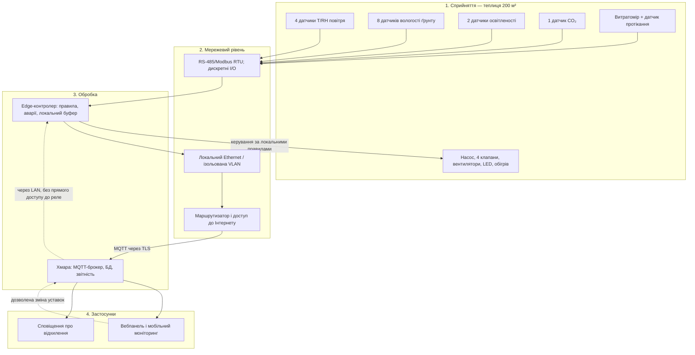

# Практична робота №1 — Розумна теплиця (200 м²)

**Дисципліна:** Технології IoT та SMART-технології  
**Тема:** Вступ до IoT та SMART-технологій  
**Варіант:** 1  
**Виконав:** Назарук Роман Леонідович, група **алк-44**, спеціальність **121 «Інженерія програмного забезпечення»**  
**Навчальний рік:** 2026  
**Формат:** аналітично-проєктний документ, без програмування.

## 1. Постановка задачі та межі проєкту

Спроєктувати автоматизовану систему підтримання мікроклімату й поливу теплиці площею 200 м². Передбачити вимірювання температури, вологості повітря та ґрунту, освітленості й CO₂; керування поливом, вентиляцією, досвітленням та обігрівом; автономну роботу без хмари; оцінку добового обсягу телеметрії.

**Статус:** концептуальне проєктування. Наведені вимоги, ціни, потужності та порогові значення, якщо не вказане джерело, — **обґрунтовані проєктні припущення**, а не підтверджені результати реального вимірювання або випробування.

## 2. Чотирирівнева архітектура IoT

**Потік даних:** датчики → польова мережа → локальний контролер → хмара → інтерфейс. **Контур керування:** контролер → виконавчі пристрої; цей контур **не залежить від Інтернету**. Мережеве обладнання відокремлене від публічної мережі.

## 3. Склад та розміщення системи

| Пристрій / кількість | Що вимірює або робить | Місце розміщення |
|---|---|---|
| 4 датчики температури/відносної вологості | T, RH | У чотирьох зонах, у тіні, на висоті рослин |
| 8 ємнісних датчиків вологості ґрунту | Вологість субстрату (2 на зону) | У кореневій зоні репрезентативних грядок |
| 2 датчики освітленості | Освітленість для рішення про досвітлення | Над рослинами, із захистом від води |
| 1 датчик CO₂ | Концентрація CO₂ | Центральна зона, подалі від вентилятора |
| 1 витратомір + 1 датчик протікання | Витрата та аварійна вода | Магістраль поливу; піддон/низина |
| 1 контролер edge із локальним сховищем | Локальні правила, журнал, черга | Герметична шафа всередині технічної зони |
| 1 насос і 4 електроклапани | Полив 4 секцій | Насосна точка та розподільний колектор |
| 2 вентилятори/приводи кватирок | Повітрообмін | Торці / покрівля теплиці |
| 4 групи LED + 1 контур обігріву | Досвітлення та обігрів | Над грядками; тепловий контур за проєктом |
| UPS, автоматика захисту, аварійний вимикач | Резерв керування, безпечне вимкнення | Технічна шафа; доступ оператора |

## 4. Сценарії та вимоги до затримки

- Кожні **60 секунд** контролер опитує датчики; відхилені або невалідні значення позначаються як помилка.
- Для навчального проєкту припускаємо уставки: температура **18–28 °C**, RH **55–75 %**, вологість ґрунту **30–45 %** (умовна шкала сенсора). Це **приклади**, які коригують для конкретної культури й калібрування.
- При низькій вологості зони, якщо немає протікання і резервуар не порожній, відкривається відповідний клапан, запускається насос; контролюється витрата, є ліміт тривалості поливу.
- При перегріві ввімкнути вентиляцію; коли T падає до нижнього порогу — обігрів. Передбачено гістерезис, щоб уникати частих перемикань.
- Досвітлення вмикати за графіком за низького освітлення, з лімітом потужності.
- **Затримка реакції на протікання:** ціль **до 1 с** від локального отримання сигналу; за наявності протікання насос зупинити, клапани закрити. Для регулювання мікроклімату прийнятні **секунди**, а для хмарного графіка — **до 5–15 с** за наявності мережі.

## 5. Edge, fog чи хмара: вибір і резервний сценарій

**Обрано edge + хмару.** Потреба припинити полив протягом приблизно 1 с при протіканні несумісна із залежністю від Інтернету. Edge-контролер має прямий доступ до реле, автономний годинник, локальні правила й сховище. Fog-сервер для однієї теплиці на 200 м² не додає істотної переваги: він створив би зайву проміжну ланку. Хмара потрібна для історії, перегляду та неаварійних налаштувань, але не для критичних команд.

**Втрата хмари:** edge продовжує опитування, полив і підтримання температури за останніми перевіреними локальними уставками; журнал записується до локальної черги щонайменше 24 год; після відновлення зв'язку послідовно передається в хмару з часовими мітками й ідентифікаторами (захист від дублювання). Без живлення на UPS працюють лише контролер, датчики й сигналізація; енергоємні навантаження зупиняються в безпечний стан. При несправності датчика — тривога та обмежений безпечний режим без безконтрольного поливу.

## 6. Розрахунок добового обсягу телеметрії

**Явні припущення:** 4 значення температури, 4 RH, 8 вологості ґрунту, 2 освітленості, 1 CO₂, 1 витрата, 1 протікання = **21 скалярне значення** щохвилини. Edge надсилає **один агрегований запис на хвилину**. Оцінка одного запису: 21 × 12 Б для чисел і назв скорочених полів + 120 Б для часової мітки, ідентифікаторів та службових полів = **372 Б/запис**.

- Кількість записів: 24 × 60 = **1 440/доба**.
- Корисне навантаження: 1 440 × 372 = **535 680 Б ≈ 0,536 МБ/доба** (десяткові МБ).
- 30 діб без стискання: **16,07 МБ**. Для локальної черги закладаємо 64 МБ із запасом.
- Це **без** накладних витрат TCP/IP, TLS, повторних передавань, MQTT і додаткових подій. Фактичний мережевий трафік буде більшим.

## 7. Безпека, аварії та приватність

| Конкретна загроза | Наслідок | Захід протидії |
|---|---|---|
| Викрадення пароля оператора | Зміна уставок, шкідливий полив | Індивідуальні облікові записи, MFA, RBAC, журнал змін, межі уставок у контролері |
| Підміна телеметрії або команд у мережі | Хибні рішення обігріву/поливу | MQTT/TLS, сертифікати пристроїв, відокремлена VLAN; хмара не може обійти локальні блокування |
| Протікання, залипання реле, відмова датчика | Затоплення, перегрів | Датчик води, витратомір, незалежні термозахисти, NC-клапани, ручне аварійне вимкнення |
| Зникнення Інтернету або електроживлення | Втрата моніторингу/керування | Локальні уставки, UPS контролера, аварійний журнал, безпечне вимкнення силових навантажень |
| Незахищене оновлення прошивки | Перехоплення контролера | Підписані оновлення, резервна версія, план регулярних патчів |

Слід збирати лише технічні дані теплиці та обмежувати доступ до журналів. Доступ до силової автоматики — лише через відповідне захисне електрообладнання та кваліфікований монтаж.

## 8. Перевірка проєктних вимог (критерії приймання)

1. Від'єднати WAN на 1 годину: локальний полив і вентиляція працюють, у черзі є всі вимірювання.
2. Імітувати протікання: насос зупиняється за проєктною ціллю до 1 с, клапани закриваються.
3. Вивести один датчик з ладу: діагностика показує збій, керування переходить у визначений безпечний режим.
4. Відновити WAN: історія донадсилається без дубльованих записів.
5. Перевірити права: користувач лише для перегляду не може змінювати уставки.

## 9. Висновок і джерела

Архітектура має чотири рівні; швидкі й аварійні рішення виконує edge, а хмару застосовано лише для історії та віддаленого огляду. Проєкт зберігає працездатність при втраті Інтернету і явно оцінює обсяг даних.

**Джерела** (дата звернення до кожного: 31.10.2026):

1. NIST. *IoT Device Cybersecurity Capability Core Baseline*, NISTIR 8259A. https://csrc.nist.gov/pubs/ir/8259/a/final (дата звернення: 31.10.2026).
2. OASIS. *MQTT Specifications*. https://mqtt.org/mqtt-specification/ (дата звернення: 31.10.2026).
3. Mermaid. *Flowcharts Syntax*. https://mermaid.js.org/syntax/flowchart.html (дата звернення: 31.10.2026).
4. Dragino. *LSE01 Soil Moisture & EC Sensor* — приклад промислового сенсора вологи. https://www.dragino.com/products/agriculture-weather-station/item/159-lse01.html (дата звернення: 31.10.2026).

## 10. Декларація використання ШІ

- **Інструмент:** ChatGPT (OpenAI, GPT-6).
- **Мета застосування:** допомога зі структурою README.md, підготовкою чернетки архітектури Mermaid, розрахунків, ризиків і списку офіційних технічних джерел для варіанта 1.
- **Текст запиту:** «Потрібно здати практичну за всіма вимогами» (у контексті наданого PDF із завданням «Практична робота 1: Вступ до IoT та SMART-технологій»).
- **Фрагменти, підготовлені за допомогою ШІ:** чернетка проєктного опису, таблиць, діаграм Mermaid, оцінок і розділу з кібербезпеки.
- **Власне доопрацювання:** **заповнити студенту після фактичної перевірки**: вказати, які припущення, розрахунки, джерела, схема та формулювання перевірені самостійно, що саме було змінено і чому. Не заявляти про перевірки, які насправді не виконувалися.

> Матеріал призначений для самостійного аналізу і доопрацювання. Під час захисту студент має пояснити логіку вибору архітектури та припущень.

> **Для захисту:** поясніть, чому система реагує локально; чим відрізняються рівні «мережа» й «обробка»; звідки взялися числа; які припущення треба перевірити на реальному обладнанні.  
> **Важливо:** ця практична робота — опис архітектури, а не програмний код.
